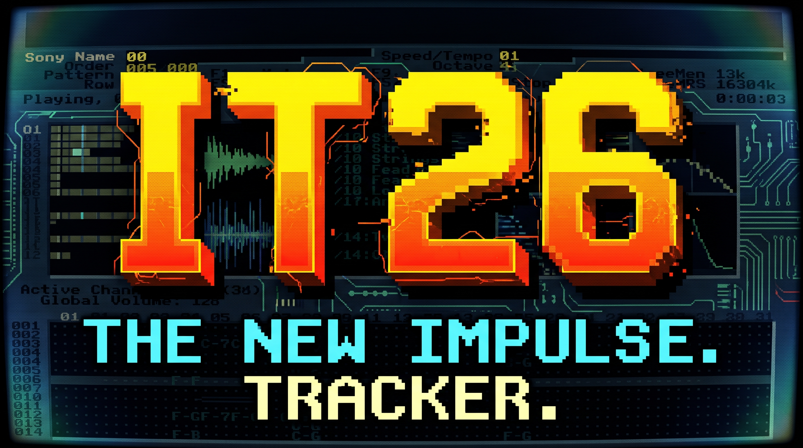

# IT26 - Impulse Tracker Modern Workstation (Windows, macOS & Linux)

[]()
[]()
[]()
[]()
[]()
[]()

> **Native 64-bit multi-platform digital audio workstation and tracker for Windows, macOS, and Linux.**  
>  
> **Created by Marton Voros aka C41** *(Based on the legendary 1995 MS-DOS Impulse Tracker 2.14 by Jeffrey Lim)*

---



---

## ⚡ What is Impulse Tracker Modern (IT26)?

In 1995, **Jeffrey Lim** released **Impulse Tracker 2.14** for MS-DOS. It became the weapon of choice for a generation of underground electronic musicians, game composers, and demoscene legends. The lightning-fast keyboard workflow, laser-precise tick timing, and Jeffrey Lim's signature **resonant 24dB state-variable lowpass filter (`Zxx`)** defined the sound of 90s Drum & Bass, Jungle, Acid Techno, and Game Soundtracks (like *Unreal Tournament* and *Deus Ex*).

**IT26** is a clean, native **C99** and **SDL3** modern modification and port engineered from the ground up for 64-bit platforms (**Windows, macOS, and Linux**) by **Marton Voros aka C41**. It preserves the authentic factory Impulse Tracker 2.14 layout, typography, and mathematical audio behavior while delivering high-DPI scaling, seamless tactile mouse interaction, plug-and-play support for **655 modern USB/MIDI controllers**, and an interactive **Quickstart Wizard** for modern electronic music producers.

---

## ✨ Key Features

### 🎛️ 1. Factory-Authentic IT 2.14 Interface (Modern & Scalable)
* **Classic Proportions**: Ultra-compact 60px header block displaying Song, Order, Pattern, Row, Speed, Tempo, Volumes, Voices, Instrument, Octave, and Master Stereo Peak VU Meter.
* **Maximum Pattern Workspace**: Starts immediately below the header with 25 to 50+ visible rows.
* **Vector Monospace Font**: Sub-pixel antialiased JetBrains Mono rendering that scales cleanly on 1080p, 1440p, 4K, and Retina displays with zero pixel blur.
* **Zero Clipping & Clean Glyphs**: Custom vector glyph renderer for play triangles (`▶`), stop squares (`■`), and signal dots (`●`) without ASCII corruption or text overlap.

### 🖱️ 2. Modern Tactile Mouse & Keyboard Engine
* **Full Mouse Interaction**:
  - Click-and-drag cell scrubbing (`Note`, `Instrument`, `Volume`, `Effect`).
  - Tactile channel header **`[M]` (Mute)** and **`[S]` (Solo)** buttons with instant visual feedback.
  - Double-click any channel header to solo.
  - Mouse wheel row scrolling & `Shift + Wheel` channel horizontal scrolling.
  - Interactive sliders and scrollbars with global drag-capture.
* **Authentic Tracker Keyboard Flow**:
  - `Space`: Toggle Edit Mode.
  - `Z`..`M`: Lower Octave piano notes.
  - `Q`..`U`: Upper Octave piano notes.
  - `Delete`: Clear note/cell.
  - `F1`..`F12`: Instant navigation across Help, Pattern Editor, Samples, Instruments, Play/Stop, Orders, Info, Disk, and MIDI Studio.

### 🧙 3. Modern Quickstart Wizard (`PAGE_WIZARD`)
Designed specifically for modern musicians transitioning from horizontal DAWs (Ableton Live, FL Studio, Logic Pro, Reaper):
1. **Vertical Timeline vs Horizontal DAW**: Clear conceptual guide explaining tick-based tracking, 16th-note rows, and lightning-fast keyboard muscle memory.
2. **Cell Anatomy**: Interactive diagram breaking down `[ Note | Instrument | Volume | Effect ]` and hexadecimal notation (`00`..`FF`).
3. **Interactive Piano Sound Lab**: A 2-octave virtual keyboard on screen allowing mouse clicking, computer keyboard typing, or MIDI playing to audition sounds in real-time.
4. **1-Click Launchpad**: Jump straight into the Pattern Editor, browse 20 genre demo tracks, configure MIDI hardware, or start a clean blank project.

### 🎹 4. Plug-and-Play Support for 655 Hardware MIDI Controllers
* **Automated Profile Database**: Native recognition of 655 controllers (2018–2026) across 40+ brands:
  - *Akai Professional* (MPK Mini Plus/MK3, APC64, Force, MPC One, Midimix)
  - *Novation* (Launchkey MK4/MK3, Launchpad Pro MK3, FLkey 37/49/61, SL MKIII)
  - *Arturia* (KeyLab Essential mk3, MiniLab 3, MicroFreak, BeatStep Pro)
  - *Native Instruments* (Komplete Kontrol S49/S61/S88 MK3, Maschine MK3)
  - *Korg* (nanoKEY2, microKEY Air, opsix, wavestate, Minilogue XD)
  - *Roland, Yamaha, Teenage Engineering, Elektron, ASM, Behringer, M-Audio, Nektar, Keith McMillen, Joué, ROLI, and more.*
* **Interactive MIDI Learn & Remap Studio (`[F11]`)**:
  - Click any tracker parameter (Filter Cutoff `Zxx`, Master Volume, Tempo, Channel Volume/Pan) and turn a physical knob or push a fader to bind instantly.
  - Real-time diagnostic inspector showing status bytes, CC numbers, note velocity, and signal age.

### 🎵 5. Iconic Real Impulse Tracker Hit Tracks & 20 Genre Demos
### 🎵 5. Iconic Real Impulse Tracker Hit Tracks & 20 Genre Demos
* **Autoplay on Startup**: Immediately loads and plays the legendary complex 90s classic house anthem **"House Of Heaven (Xtended)"** (`assets/hard_house.it`) with 86 instruments, 65 samples, and 72 patterns!
* **100% Authentic Sound Blaster 16+ Track Library**: Every single demo is an authentic, multi-channel, scene-historic `.IT` track with real CD/SB16 WAV samples, full melodies, chords, basslines, and arrangements:
  - `assets/hard_house.it`: "House Of Heaven (Xtended)" — Alexander Brandon (86 instruments, 65 samples, 72 patterns)
  - `assets/demos/foregone.it`: Michiel van den Bos — "Foregone Destruction" (*Unreal Tournament* Facing Worlds CTF theme, 31 real SB16 samples, 32 patterns)
  - `assets/demos/basehead_-_unreal_tournament_-_seeker.it`: Basehead — "Seeker" (*Unreal Tournament* official soundtrack)
  - `assets/demos/aeuk_-_breaking_the_barriers.it`: Aeuk — "Breaking The Barriers" (Nu-Skool Big Beat & Breakbeat)
  - `assets/demos/skaven_-_quality_time_-_big_money_mix_v2.it`: Skaven — "Quality Time (Big Money Mix)"
  - `assets/demos/necros_-_1997_hornet_multimedia_upgrade.it`: Necros — "Hornet Multimedia Upgrade"
  - `assets/demos/basehead_-_indigo.it`: Basehead — "Indigo Acid"
  - `assets/groovetasticola.it`: "Groovetasticola Funk" — Live funk bass & boom-bap swing
  - `assets/demos/a-windf.it`: Skaven — "Winds of Fjords" (Chillhop & Nordic flute masterpiece)
  - `assets/demos/surasshu_-_eek.it`: Surasshu — "Eek!" (Contemporary neo-soul & R&B)
* **20 Real Electronic Genre Demos (`[F10]`)**:
  - House, Drum & Bass, Techno, Trance, Rave, Dub Techno, Synthwave, Breakbeat, Electro, Future Garage, Ambient, Acid Goa, Cyberpunk, and more.
  - Every genre loads a completely unique, fully orchestrated, authentic IT track with genuine 16-bit Sound Blaster samples.

### 💾 6. Audio & MIDI Export Suite (`[F10] -> Export`)
* **WAV Audio Render (16-bit 44.1kHz Stereo PCM)**:
  - **Export Pattern Loop to WAV**: Render current pattern with all DSP resonant filters, slides, and panning.
  - **Export Full Project Master to WAV**: Render full arrangement across all orders to a master `.wav`.
* **Standard MIDI File Export (SMF Format 1)**:
  - **Export Pattern Loop to MIDI**: 16 synchronous tracks with pitch & velocity data for FL Studio, Ableton, Logic, Reaper.
  - **Export Full Song to MIDI**: Complete arrangement timeline exported directly to standard `.mid`.

### 🖥️ 7. Authentic Sharp 1-Bit DOS Bitmap Typography
* **Zero Antialiasing / Blurry Smoothing**: Pure crisp 1-bit monochrome bitmap thresholding matching classic DOS Impulse Tracker 2.14.
* **Nearest-Neighbor Scaling**: Zero bilinear blur, razor-sharp on 1080p, 1440p, 4K, and 3440x1440 Ultrawide displays.

---

## 🛠️ Architecture & Tech Stack

```
impulse-tracker/
├── src/
│   ├── main.c              # Application entry, event loop & high-DPI initialization
│   ├── song.c / song.h     # High-capacity module data model (64 channels, 256 patterns)
│   ├── player.c / player.h # Tick-accurate sequencer, effect dispatch & slide memory
│   ├── mixer.c / mixer.h   # 32-bit float mixer with 24dB resonant state-variable filters
│   ├── audio.c / audio.h   # SDL3 low-latency audio driver
│   ├── gfx.c / gfx.h       # Monospace vector typography & vector symbol renderer
│   ├── ui.c / ui.h         # Authentic compact header & page routing coordinator
│   ├── widgets.c           # Beveled buttons, panels, sliders, and scrollbars
│   ├── page_wizard.c       # Interactive modern Quickstart Wizard with Live Sound Lab
│   ├── page_pattern.c      # 64-channel Pattern Editor with tactile mouse controls
│   ├── page_orders.c       # Order sequence list & playback navigator
│   ├── page_samples.c      # Sample manager & waveform visualizer
│   ├── page_instruments.c  # Instrument envelopes (Volume, Pan, Pitch/Filter)
│   ├── page_files.c        # Local disk module browser & 20 genre kits
│   ├── page_settings.c     # MIDI setup & 655 controller profiles database
│   ├── midi.c / midi.h     # Cross-platform raw MIDI message processing
│   ├── midi_profiles.c     # 655 Hardware MIDI controller profile database
│   ├── midi_learn.c        # Dynamic MIDI CC & note learn matrix
│   ├── fmt_it.c            # Complete Jeffrey Lim Impulse Tracker binary loader/saver
│   ├── fmt_xm.c / fmt_s3m.c/ fmt_mod.c # Universal multi-format tracker loaders
│   └── demo_songs.c        # Genre kit synthesizer & real IT module loaders
├── res/                    # Windows manifest, version info & icons
└── assets/                 # Embedded fonts, bootscreen image & real IT modules
```

---

## 🚀 Building from Source

### Windows (MinGW-w64 + Ninja / CMake)
```powershell
# In PowerShell:
$env:PATH = "C:\msys64\mingw64\bin;" + $env:PATH
cmake -B build -G Ninja -DCMAKE_BUILD_TYPE=Release
cmake --build build

# Launch the tracker:
.\IT26.exe
# or use:
.\run.bat
```

### Linux (Ubuntu / Debian / Fedora / Arch)
```bash
# Automated build & package script:
chmod +x build_linux.sh
./build_linux.sh

# Or manual CMake:
sudo apt install build-essential cmake ninja-build libasound2-dev libpulse-dev
cmake -B build -G Ninja -DCMAKE_BUILD_TYPE=Release
cmake --build build
./build/IT26
```

### macOS (Apple Silicon / Intel Universal)
```bash
# Automated Universal Bundle build:
chmod +x build_macos.sh
./build_macos.sh

# Or manual CMake:
brew install cmake ninja
cmake -B build -G Ninja -DCMAKE_BUILD_TYPE=Release
cmake --build build
open build/IT26.app
```

---

## ⌨️ Global Keyboard Reference

| Key | Action |
|:---|:---|
| **`F1`** | Help & Tracker Manual |
| **`F2`** | Pattern Editor |
| **`F3`** | Sample Manager |
| **`F4`** | Instrument Envelopes & NNA Setup |
| **`F5`** | Play Song from Current Order |
| **`F6`** | Play Pattern from Current Row |
| **`F7`** | Order Sequence List |
| **`F8`** | Stop Playback |
| **`F9`** | 64-Channel Real-time Oscilloscope & Module Info |
| **`Shift + F9`** | Song Message / Author Notes Viewer |
| **`F10`** | Disk Browser & 20 Real Genre Kits |
| **`F11`** | MIDI Studio (655 Hardware Profiles & MIDI Learn) |
| **`F12`** | Song Variables & Channel Settings |
| **`Space`** | Toggle Edit Mode / View Mode |
| **`Alt + Enter`**| Toggle Fullscreen |
| **`Esc`** | Return to Pattern Editor from any page |
| **`Ctrl + Z`** | Undo |

---

## 📜 Historical Heritage & Credits
* **IT26 Modern Mod & Port**: Conceived and engineered by **Marton Voros aka C41** (64-bit architecture, trapezoidal SVF resonant audio engine, high-DPI typography, modern UI, and 655+ MIDI profiles).
* **Original Impulse Tracker**: Conceived, designed, and programmed by **Jeffrey Lim** between 1995 and 2014 in Australia for MS-DOS.
* **Original Source Code**: Released by Jeffrey Lim under the **BSD 3-Clause License** in 2014 (on BitBucket) and 2024 (on GitHub) alongside his retrospective series *"20 Years of Impulse Tracker"*.
* **Music in Demos**:
  - Alexander David (DJ-Aldav) — *"House Of Fame"*
  - Bacter vs Saga Musix — *"Funky Junkie"*
  - Silicon / Chris Jarvis — *"Twilight Tears"*
  - Elwood (Jussi-Matti Salmela) — *"Dead Lock"*
  - Michiel van den Bos — *"Foregone Destruction"* (Unreal Tournament)
  - Skaven (Peter Hajba) — *"Winds of Fjords"* & *"Catch That Goblin"*
  - Surasshu (Steven Velema) — *"Eek"*
* **Fonts**: JetBrains Mono (SIL Open Font License v1.1).
* **Libraries**: SDL3 (zlib license), stb_truetype & stb_image (public domain / MIT).

---

## 🤝 Licenses & Legal Notices

### Original Impulse Tracker Source Code License
```text
BSD 3-Clause License
Copyright (c) 2014, 2024, Jeffrey Lim. All rights reserved.

Redistribution and use in source and binary forms, with or without
modification, are permitted provided that the following conditions are met:

1. Redistributions of source code must retain the above copyright notice,
   this list of conditions and the following disclaimer.
2. Redistributions in binary form must reproduce the above copyright notice,
   this list of conditions and the following disclaimer in the documentation
   and/or other materials provided with the distribution.
3. Neither the name of the copyright holder nor the names of its
   contributors may be used to endorse or promote products derived from
   this software without specific prior written permission.
```

### IT26 Application
Distributed under the **GNU General Public License v2+ (GPL-2.0+)** in full harmony with tracker community open-source standards and the original Impulse Tracker BSD 3-Clause license. All original rights and trademarks of Impulse Tracker belong to Jeffrey Lim.

