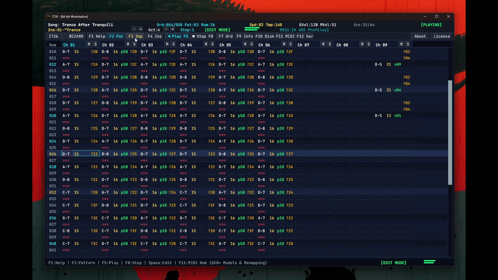

# IT26 Workstation

[](https://github.com/martonvoros/it26/releases)
[]()
[]()
[]()
[](LICENSE)

**IT26** is a modern, 64-bit digital audio workstation and native port of the classic MS-DOS **Impulse Tracker 2.14**. Engineered in C99 and SDL3, it preserves the ergonomics and workflow of the original tracker while providing studio-grade 32-bit floating-point audio processing, trapezoidal state-variable resonant filters, sub-pixel vector typography, and USB/hardware MIDI controller integration.

Conceived and developed by **Marton Voros aka C41**, based on the original Impulse Tracker source code by **Jeffrey Lim**.

---

## Downloads

Pre-built binaries are available for 64-bit platforms without requiring a build environment:

| Platform | Download | Package Type & Details |
|:---|:---|:---|
| **Windows Installer** (x86_64) | [**IT26-Windows-x64-Setup-v1.0.4.exe**](https://github.com/martonvoros/it26/releases/download/v1.0.4/IT26-Windows-x64-Setup-v1.0.4.exe) | Signed Setup: desktop/start menu shortcuts, file associations (`.it`, `.xm`, `.s3m`, `.mod`) & certificate trust |
| **Windows Portable** (x86_64) | [**IT26-Windows-x64-v1.0.4.zip**](https://github.com/martonvoros/it26/releases/download/v1.0.4/IT26-Windows-x64-v1.0.4.zip) | Standalone portable archive: extract and run `IT26.exe` |
| **Linux** (x86_64) | Source / `build_linux.sh` | Portable binary with ALSA / PulseAudio & `.desktop` integration |
| **macOS** (Universal) | Source / `build_macos.sh` | Native Universal Binary (`arm64` + `x86_64`) `IT26.app` bundle |

---

## Demonstration

[](https://github.com/martonvoros/it26/releases/download/v1.0.4/IT26.mp4)

> 🎬 **[Watch High-Definition Demo Video (IT26.mp4)](https://github.com/martonvoros/it26/releases/download/v1.0.4/IT26.mp4)** — 1080p full-screen capture showcasing live 138 BPM playback, sub-pixel vector rendering, audio spectrum visualizer, and keyboard-driven sequencing.

---

## Overview & Architecture

### Audio Engine
* **32-Bit Float Internal Processing**: Fully floating-point mixing pipeline operating up to 64 virtual playback channels.
* **Trapezoidal State-Variable Filters (SVF)**: Unconditionally stable resonant low-pass filter implementation accurately modeling Jeffrey Lim's `Zxx` filter response.
* **Hermite Spline Sample Interpolation**: 4-point Hermite polynomial interpolation for clean, anti-aliased sample transposition without high-frequency crunch.
* **Analog Soft-Saturation Output**: Continuous `tanh`-based tape saturation curve eliminating harsh digital clipping.
* **Tick-Accurate Sequencer**: Authentic effect processor supporting slides, arpeggio, vibrato (`H`, `U`), portamento (`G`), sample offsets (`O`), and past-note actions (NNA).

### Interface & Controls
* **Pixel-Perfect Vector Display**: Monospace sub-pixel rendering with custom vector symbols, scaling cleanly on 1080p, 1440p, 4K, and Ultrawide displays.
* **Dual Input Paradigm**: Full classic MS-DOS keyboard shortcuts alongside modern tactile mouse interaction (cell scrubbing, channel muting/soloing, envelope dragging).
* **Startup Splash**: Compact animated modal featuring live audio-reactive spectrum analysis and hardware initialization status.

### Hardware MIDI Support
* **Plug-and-Play Integration**: Native support for USB and DIN MIDI input devices.
* **Over 650 Pre-Mapped Hardware Profiles**: Factory mappings for Akai, Novation, Arturia, Native Instruments, Korg, Roland, and M-Audio controllers.
* **Interactive MIDI Learn Studio**: Real-time parameter binding for filter cutoff, volume, and transport controls.

---

## Supported File Formats

| Format | Extensions | Capabilities |
|:---|:---|:---|
| **Impulse Tracker** | `.it` | Full read / write, instrument envelopes, NNA, filters |
| **FastTracker II** | `.xm` | Multi-channel import, volume envelopes |
| **Scream Tracker 3**| `.s3m`| Multi-channel import, sample playback |
| **ProTracker** | `.mod` | 4-to-32 channel Amiga/PC module playback |
| **Audio Export** | `.wav` | 16-bit 44.1 kHz stereo master and pattern loop render |
| **MIDI Export** | `.mid` | Standard MIDI File (SMF Format 1) multi-track export |

---

## Building from Source

### Prerequisites
* C99 compiler (GCC, Clang, or MSVC)
* CMake 3.16+
* Ninja or Make
* SDL3 (automatically fetched via CMake if not installed)

### Windows (MinGW-w64)
```powershell
cmake -B build -G Ninja -DCMAKE_BUILD_TYPE=Release
cmake --build build
.\IT26.exe
```

### Linux (Ubuntu / Debian / Fedora / Arch)
```bash
sudo apt install build-essential cmake ninja-build libasound2-dev libpulse-dev
./build_linux.sh
```

### macOS (Universal Binary)
```bash
brew install cmake ninja
./build_macos.sh
```

---

## Default Key Bindings

| Shortcut | Description |
|:---|:---|
| `F1` | Help & Documentation |
| `F2` | Pattern Editor |
| `F3` | Sample Manager |
| `F4` | Instrument Envelopes & NNA |
| `F5` / `F8` | Play Song / Stop Playback |
| `F6` | Play Current Pattern from Cursor |
| `F7` | Order List |
| `F9` | 64-Channel Real-time Visualizer & Module Info |
| `F10` | Disk Browser & Sample Kits |
| `F11` | MIDI Configuration & Learn Studio |
| `F12` | Song Variables & Channel Pan/Volume |
| `Space` | Toggle Edit Mode |
| `Alt + Enter` | Toggle Fullscreen |
| `Esc` | Return to Pattern Editor |

---

## Heritage & Attribution

* **IT26 Modern Mod & Port**: Conceived and developed by **Marton Voros aka C41**.
* **Original Impulse Tracker**: Designed and programmed by **Jeffrey Lim** between 1995 and 2014 in Australia for MS-DOS.
* **Original Source Code**: Released by Jeffrey Lim under the **BSD 3-Clause License** in 2014 and 2024.

---

## License

IT26 is released under the **GNU General Public License version 2 or later (GPL-2.0+)**, incorporating specifications and components from the original Impulse Tracker source code released under the **BSD 3-Clause License**:

```text
Copyright (c) 2014, 2024, Jeffrey Lim. All rights reserved.

Redistribution and use in source and binary forms, with or without
modification, are permitted provided that the following conditions are met:

1. Redistributions of source code must retain the above copyright notice,
   this list of conditions and the following disclaimer.
2. Redistributions in binary form must reproduce the above copyright notice,
   this list of conditions and the following disclaimer in the documentation
   and/or other materials provided with the distribution.
3. Neither the name of the copyright holder nor the names of its
   contributors may be used to endorse or promote products derived from
   this software without specific prior written permission.
```

See [LICENSE](LICENSE) for full licensing details, including third-party component notices (SDL3, stb, JetBrains Mono).
